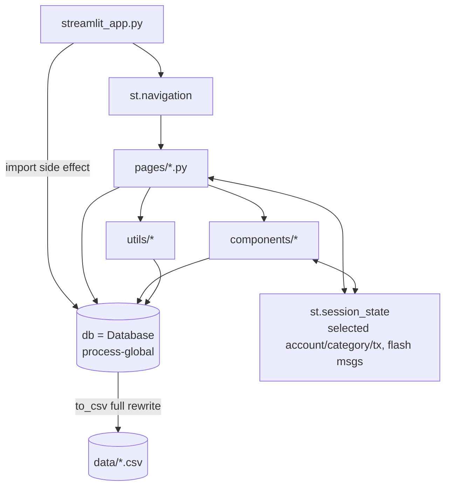
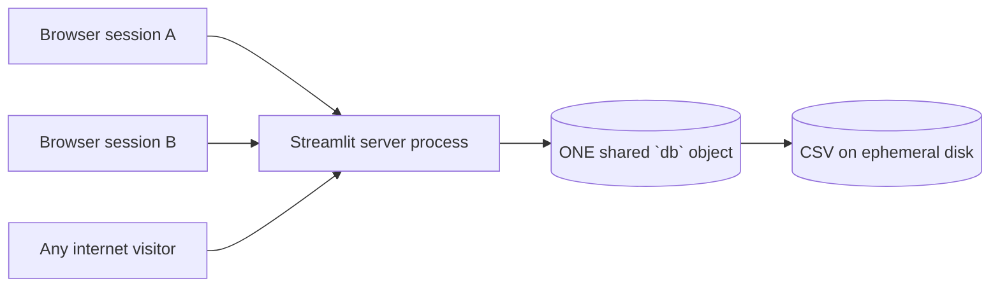

# Engineering Review — Income Exchange (project_01)

Review date: 2026-11-24 · Read-only · Branch `master` @ `59f4907`

## Method & coverage

- **Read in full:** every tracked `.py` file (2,108 LOC, 30 files), `pyproject.toml`, `uv.lock` (versions), `Makefile`, `README.md`, `.gitignore`, `.python-version`, `app/.streamlit/config.toml`, CSV headers, git log (80 commits, 18 merges, 7 branches).
- **Executed (on a scratchpad copy of `app/` + `data/`, repo untouched):** data-integrity script against real CSVs; Streamlit `AppTest` render of home/stats/accounts/categories (0 exceptions); `AppTest` click of "Add Expense"; scripted reproduction of transfer delete and account rename; timing of queries and page renders.
- **Installed versions (verified via `.venv`):** Python 3.15.2, Streamlit 1.67.0, pandas 3.1.1, pydantic 2.14.3, plotly 7.1.0, iso4217 1.16.20260101. API availability (`st.connection`, `st.fragment`, `st.metric(chart_data=…)`, `st.query_params`, `st.login`, `st.dialog(on_dismiss=…)`, `AppTest`) checked by introspection of installed 1.67.
- **Not verified:** live deployment (Community Cloud link not opened), visual rendering in browser, `media/demo.mov`. Doc links below are stable official URLs; I did not fetch them this session, so version-specific claims rest on installed-package introspection.
- **Review mode:** specialist passes run sequentially (no subagents), then a critic pass that re-checked every High finding by execution.

---

## A. Executive summary

| | |
|---|---|
| **Purpose** | Personal expense tracker: accounts, categories, income/expense/transfer transactions, monthly budget warning, stats dashboards. |
| **Stack** | Python 3.15 · Streamlit 1.67 (multipage `st.navigation`) · pandas 3.1 · pydantic 2.14 · Plotly 7 · CSV files · uv |
| **Architecture** | Layered-ish: `pages/` (scripts) → `components/` (widgets) → `db/database.py` (module-level singleton wrapping three DataFrames, persisted to CSV). Pydantic models in `data/models.py`. |
| **Overall verified score** | **48 / 100** |
| **Coverage** | 100% of applicable weight evaluated (DevOps and UI at Low/Medium confidence) |
| **Maturity** | Solid bootcamp / prototype level. Built in 5 days (2026-11-19 → 23) with a real PR workflow. Not safe for multi-user or real money data. |

**Context for the score:** rubric measures against professional standards, not "good for 5 days". For a 5-day first project, structure and feature completeness are above average. Score is dragged down by a handful of correctness bugs that share **one root cause** (stored derived state + global mutable state) and by zero tests.

**Top strengths**
1. Clear folder split (pages / components / data / db) and constants for session keys and page paths.
2. Pydantic models with UUIDs, enums, `Literal` colors, field validators for NaN — real typed domain layer.
3. Good use of current Streamlit: `st.navigation(position="top")`, `st.dialog`, `st.grid`, `on_change` callbacks with `args`, empty-state handling everywhere.
4. Feature-branch + PR workflow (15 PRs), uv lockfile, README with run command and live link.

**Top weaknesses**
1. **Account balance is stored, not derived** → drifts. Committed data already wrong: *Emergency Savings* stored `0.0`, true `364.19`.
2. **One `Database()` object shared by every browser session** on a public, unauthenticated deployment.
3. **"Add" writes a transaction immediately** (amount 1) with no cancel and no balance update.
4. No tests, no linter, no type checker.

**Biggest missed technology opportunity:** `streamlit.testing.v1.AppTest` — already installed, reproduced 3 of your bugs in ~20 lines during this review. Close second: SQLite (`sqlite3` / `st.connection`) instead of CSV + global DataFrames.

**Single most valuable lesson:** *Store facts, derive everything else.* A balance is a function of transactions; storing it creates N places that must remember to update it — you missed 3 of them.

---

## B. Assessment dashboard

| Category | Weight | Score | Confidence | Main observation | Priority |
|---|---:|---:|---|---|---|
| Architecture & structure | 10% | 6 | High | Clean folders; DB is global singleton; business logic in page scripts | Medium |
| Correctness & business logic | 10% | 4 | High | 5 confirmed bugs (balance drift ×3, phantom tx, wrong pie) | **High** |
| Technology utilization | 10% | 5 | High | Modern Streamlit UI APIs used well; caching/connection/testing/forms/metric missed | High |
| Code quality & readability | 8% | 6 | High | Readable, consistent naming; dead code, invalid annotation, magic values | Low |
| Design & maintainability | 8% | 5 | High | 3 near-identical detail grids, duplicated stats blocks, hidden global coupling | Medium |
| Security & privacy | 8% | 4 | Medium | Public app, no auth, all visitors share one dataset | High (if real use) |
| State management & data flow | 7% | 4 | High | Process-global mutable DFs, in-place mutation, stale session copies | **High** |
| Performance | 7% | 7 | High | Measured fine (home render ~470 ms, query 3.4 ms @ 926 rows) | Low |
| Testing & QA | 6% | 1 | High | No tests of any kind | **High** |
| Data modeling & persistence | 5% | 5 | High | Good pydantic models; float money, CSV non-atomic, derived column stored | Medium |
| Error handling & reliability | 5% | 5 | Medium | Good empty states; no IO error handling, dead `if not account` checks | Low |
| DX & tooling | 4% | 4 | High | uv + lock + Makefile good; no ruff/pyright/pre-commit, `sys.path` hack | Medium |
| UI/UX & accessibility | 4% | 6 | Medium | Nice toasts/empty states/month nav; autosave-per-keystroke, no cancel, empty labels | Low |
| DevOps & deployment | 4% | 4 | Low | Deployed, but ephemeral storage, no CI, config file likely ignored | Low |
| Docs & version control | 4% | 6 | High | Good README + PR flow; vague/duplicate commit messages, no arch notes | Low |
| **Overall** | **100%** | **48.3** | | | |

Calculation: Σ(score × weight) = 60+40+50+48+40+32+28+49+6+25+25+16+24+16+24 = 483 → 483 / 10 = **48.3**. No N/A or N/V categories.

---

## C. Current architecture

```
app/
├── streamlit_app.py        # entry: sys.path hack, imports db (side effect), st.navigation
├── .streamlit/config.toml  # fully commented out
├── db/database.py          # Database class + module-level `db = Database()` singleton
├── data/                   # models.py (pydantic), constants (colors, icons, keys, paths), mock_data.py (unused)
├── components/             # *_details_grid.py (edit forms), alert, show_missing, stat_container, home/*
├── pages/                  # 6 page scripts; contain stats/pandas logic inline
└── utils/                  # home_utils, stats_util (import global db)
data/*.csv                  # committed "database"
```



**Data flow for an edit:** widget `on_change` → callback reads pydantic copy from `session_state` → `model_copy(update=…)` → `db.save(copy, "edit")` → mutates global DataFrame + rewrites entire CSV → (transactions only) `update_account_balance` recomputes and rewrites accounts CSV → rerun.

**Strengths:** dependency direction mostly one-way (pages → components → db); models isolated; constants centralized.

**Weaknesses:** every layer reaches the global `db` directly (no injection, untestable without file IO); pages hold domain logic (balance stats, merges, resampling); `Database` mixes persistence, querying, and business rules (balance).



---

## D. What you did well

1. **Typed domain models with pydantic** (`app/data/models.py`). UUID ids, `TransactionType(str, Enum)`, `BadgeColor` Literal reused for `get_args` in selectboxes, `field_validator(mode="before")` to normalize pandas NaN → `None`/`""`. *Why good:* one place defines validity; CSV quirks contained at the boundary. *Repeat:* yes. *Becomes inappropriate:* converting every row to a model on every rerun once you have 100k+ rows — then validate on write, query with vectorized/SQL operations.
2. **Constants for session keys and page paths** (`streamlit_state_keys.py`, `page_paths.py`). Prevents typo bugs with Streamlit's stringly-typed state. *Repeat:* yes. A further step is a typed wrapper (see F10).
3. **Flash-message pattern** (`components/alert.py`). Set message in state → `switch_page` → show toast on next page → clear. Correct answer to "toast disappears on navigation". *Repeat:* yes.
4. **Empty-state handling** (`show_missing_and_stop` used in every page). Every page degrades to a helpful gray message instead of a traceback; `AppTest` confirmed all 4 list pages render with 0 exceptions. *Repeat:* yes.
5. **Referential-integrity guards on delete** (`pages/account.py:37-44`, `pages/category.py:40-44`). You thought about orphaned transactions. *Repeat:* yes — but enforce in the persistence layer (FK constraint) instead of the UI.
6. **Delete confirmation via checkbox + disabled button** (`components/home/transaction.py:27-38`). Lightweight, avoids modal-in-modal. Good.
7. **Transfer creation only offers same-currency accounts** (`actions_col.py:53-60`). Correct domain thinking (but see F06 — edit path loses it).
8. **Workflow:** 7 feature branches, 15 merged PRs in 5 days, uv lockfile, `.python-version`, Makefile `run`, README with live link and AI-assist disclosure. Professional habits most bootcamp projects skip.

---

## E. Detailed findings

### F01 — Process-global database shared by all users of a public deployment
- **Category:** State management · Security · Architecture
- **Location:** `app/db/database.py:181` (`db = Database()`), imported by 12 modules; README live link
- **Severity:** High (Critical if real financial data is ever entered) · **Confidence:** High · **Classification:** Confirmed issue
- **Current:** module-level singleton. Python imports a module once per process; Streamlit runs every browser session in the same process.
- **Evidence:** during the review, a click inside an `AppTest` session changed `app.db.database.db.Transactions` as seen by my outer script (926 → 927 rows) — same object across "sessions". No auth anywhere (`grep login/auth` → none).
- **Why it matters:** any visitor to the live URL sees, edits, and deletes everyone's data. Two simultaneous edits race: both do `df.copy()` → modify → `setattr` → `to_csv`; last writer wins and silently discards the other (`database.py:70-90`).
- **Recommended:** decide explicitly: (a) single-user local app → document it, keep it; (b) shared demo → per-session data (`st.session_state`) seeded from a read-only sample; (c) real multi-user → auth (`st.login`, available in 1.67) + per-user rows in a real DB.
- **Before/after (option b, demo-safe):**
  ```python
  # before
  db = Database()
  # after
  def get_db() -> Database:
      if "db" not in st.session_state:
          st.session_state.db = Database.from_seed(SEED_DIR)   # in-memory per visitor
      return st.session_state.db
  ```
- **Trade-offs:** per-session data is lost on refresh; real auth adds secrets/config.
- **Effort:** Small (b) / Large (c) · **Verify:** two `AppTest` instances; write in one, assert other unchanged.
- **Lesson:** *Know your framework's execution model before choosing where state lives.* In Streamlit: module globals = per process (all users); `st.cache_resource` = per process, explicit; `st.session_state` = per tab.
- **Docs:** https://docs.streamlit.io/develop/concepts/architecture/session-state · https://docs.streamlit.io/develop/concepts/architecture/caching · https://docs.streamlit.io/develop/concepts/connections/authentication · https://owasp.org/Top10/A01_2021-Broken_Access_Control/

### F02 — Stored `balance` drifts from transactions (3 confirmed paths)
- **Category:** Correctness · Data modeling
- **Location:** `models.py:31`, `database.py:171-179`, `actions_col.py:87`, `transaction.py:40-41`, `account_details_grid.py:13-21`
- **Severity:** High · **Confidence:** High · **Classification:** Confirmed issue
- **Current:** `balance` persisted in `bank_accounts.csv`; each write path must remember to call `update_account_balance`.
- **Evidence (all reproduced):**
  1. Committed data: *Emergency Savings* stored `0.0`, computed `364.19`.
  2. Add path: click "Add Expense" → row added, stored balance `3052.715`, true `3051.715` (no update call in `_open_create_transaction_dialog`).
  3. Delete transfer: `transaction.py:41` updates only `account_id`; destination stored `1865.861`, true `1794.94`.
  4. Rename account with a stale session copy: `db.save(copy,"edit")` writes every field incl. old balance → stored `3122.636`, true `3622.636`.
- **Why it matters:** the number users trust most is wrong, silently, with no way to self-heal. Also forced your latest commit to remove `ge=0` from `balance` (`59f4907`) — a symptom fix.
- **Recommended:** delete the column. Compute on read: one vectorized groupby for all accounts.
  ```python
  # after
  def balances(tx: pd.DataFrame) -> pd.Series:
      signed = tx.amount.where(tx.type != "expense", -tx.amount)
      out  = signed[tx.type != "transfer"].groupby(tx.account_id).sum()
      t    = tx[tx.type == "transfer"]
      return (out
              .sub(t.groupby("account_id").amount.sum(), fill_value=0)
              .add(t.groupby("to_account_id").amount.sum(), fill_value=0))
  ```
  If you ever need an opening balance, store it as an "opening balance" transaction — still a fact, not a derivative.
- **Trade-offs:** recompute cost — measured 3.4 ms for 926 rows; irrelevant until ~10⁶ rows, and SQL `SUM` handles that.
- **Effort:** Small · **Verify:** property test: after any random sequence of add/edit/delete, `balance(acc) == Σ signed amounts`.
- **Lesson:** single source of truth; derived data is cached data, and cache invalidation is the hard part.
- **Docs:** https://pandas.pydata.org/docs/user_guide/groupby.html

### F03 — "Add" persists a placeholder transaction immediately; no cancel
- **Category:** Correctness · UX
- **Location:** `components/home/actions_col.py:78-101`
- **Severity:** High · **Confidence:** High · **Classification:** Confirmed issue
- **Current:** button click → `Transaction(amount=1, title=<first category>)` → `db.save(..., "add")` → open dialog bound to that saved row.
- **Evidence:** `AppTest` click on `add_expense`: rows 926 → 927 without user input. Create dialog has no `on_dismiss="rerun"` (edit dialog has it, `transaction.py:15`), so the list doesn't refresh after closing either.
- **Why it matters:** every accidental click or "I changed my mind" leaves a 1.000 BHD expense, and (F02) a wrong balance. Users must find and delete it.
- **Recommended:** draft-then-commit. Hold the draft in `st.form` inside the dialog; save only on submit.
  ```python
  @st.dialog("Create expense")
  def create_dialog(account):
      with st.form("new_tx"):
          title  = st.text_input("Title")
          amount = st.number_input("Amount", min_value=0.001, format="%.3f")
          cat    = st.selectbox("Category", categories, format_func=lambda c: c.name)
          ok = st.form_submit_button("Save", type="primary")
      if ok:
          try:
              tx = Transaction(title=title, amount=amount, category_id=cat.id,
                               account_id=account.id, type=TransactionType.EXPENSE)
          except ValidationError as e:
              st.error(e.errors()[0]["msg"]); return
          repo.add(tx); st.rerun()
  ```
- **Trade-offs:** loses "live autosave" feel; gains atomic, cancellable create and one write instead of one per field.
- **Effort:** Small–Medium · **Verify:** `AppTest`: click add, close dialog → row count unchanged.
- **Lesson:** separate *draft state* (UI) from *committed state* (DB). Applies to every framework.
- **Docs:** https://docs.streamlit.io/develop/api-reference/execution-flow/st.form · https://docs.streamlit.io/develop/api-reference/execution-flow/st.dialog

### F04 — Shared DataFrame mutated in place; rewrites every date in the CSV
- **Category:** State management · Data integrity
- **Location:** `utils/home_utils.py:10-11`
- **Severity:** Medium · **Confidence:** High · **Classification:** Confirmed issue
- **Current:** `df = db.Transactions` (alias, not copy) → `df["date"] = pd.to_datetime(...)` converts the global column.
- **Evidence:** after rendering home + one add, `transactions.csv` dates changed from `2026-06-01` (10 chars ×926) to `2026-06-01 00:00:00` (19 chars ×926) with the new row at 10 — mixed formats in one column. Parsing still works today (pydantic accepts zero-time datetimes), so this is latent, not yet broken.
- **Why it matters:** any reader anywhere now sees a type depending on whether the home page ran first in this process. Classic action-at-a-distance bug; will bite as soon as something does string comparison on dates.
- **Recommended:** parse types once at load (`pd.read_csv(path, parse_dates=["date"], dtype={...})`) and never mutate shared frames in readers; use `.assign()` which returns a new frame.
  ```python
  # before
  df = db.Transactions; df["date"] = pd.to_datetime(df["date"])
  # after
  df = db.Transactions.assign(date=lambda d: pd.to_datetime(d["date"]))
  ```
- **Effort:** Small · **Verify:** snapshot CSV, render every page via `AppTest`, assert file bytes unchanged.
- **Lesson:** in Python, `=` binds a name, never copies. Treat shared data as immutable; pandas 3 Copy-on-Write protects *derived* frames, not the original you assign into.
- **Docs:** https://pandas.pydata.org/docs/user_guide/copy_on_write.html · https://pandas.pydata.org/docs/reference/api/pandas.read_csv.html

### F05 — Account page charts/tables use the wrong rows
- **Category:** Correctness
- **Location:** `pages/account.py:141-166` (pie), `168-182` (overview)
- **Severity:** Medium · **Confidence:** High · **Classification:** Confirmed issue
- **Evidence:** pie built from `db.Transactions[type=="expense"]` with no account filter → every account shows the global category breakdown. Overview uses inner `merge` on `category_id` → transfers (no category) silently disappear from the account's history.
- **Recommended:** filter by `account.id` before grouping; `how="left"` on the merge and label transfers.
- **Effort:** Small · **Verify:** test with two accounts having disjoint categories.
- **Lesson:** when the same chart code is copy-pasted (category page → account page), the filter is the part that gets forgotten. Extract a function taking the filtered frame as an argument (see F09).

### F06 — Currencies mixed in aggregates and transfers
- **Category:** Correctness · Business rules
- **Location:** `pages/category.py:81-111`, `pages/account.py:141`, `transaction_details_grid.py:111-119`, `account_details_grid.py:105-121`
- **Severity:** Medium · **Confidence:** High (code) / currently latent in data (0 cross-currency rows; FJD account has no transactions)
- **Evidence:** dashboard correctly filters by currency (`stats_util.py:14`), but category totals and "% of overall spending" sum BHD + FJD. Transfer *creation* enforces same currency; transfer *edit* lists all accounts. Changing an account's currency after it has transactions reinterprets every amount.
- **Recommended:** decide the rule (no multi-currency aggregation / convert with rates) and enforce it in one domain function used by both create and edit. Block currency change if transactions exist.
- **Effort:** Small · **Lesson:** a business rule enforced in only one UI path is not enforced.

### F07 — Money stored as `float`
- **Category:** Data modeling · Correctness
- **Location:** `models.py:31,35,57`; CSV `3052.715000000001`; formatting `.2f` (`accounts.py:73`, `account.py:90`) vs `.3f` (`stats.py`) vs `currency.exponent` (`transaction.py:77`)
- **Severity:** Medium · **Confidence:** High · **Classification:** Confirmed issue (precision artifacts visible in data)
- **Why it matters:** binary floats can't represent 0.1; sums accumulate error. BHD has 3 decimals, yet account list shows 2 — users see rounded, inconsistent numbers.
- **Recommended:** integer minor units (fils/cents) in storage, or `Decimal` in pydantic (`condecimal(max_digits=14, decimal_places=3)`). One `format_money(amount, currency)` helper using `currency.exponent` everywhere.
- **Trade-offs:** pandas aggregates are fastest on int64 minor units; `Decimal` columns become `object` dtype (slower, fine at this scale).
- **Effort:** Medium · **Lesson:** never use binary float for money.
- **Docs:** https://docs.python.org/3/library/decimal.html · https://docs.pydantic.dev/latest/api/types/#pydantic.types.condecimal

### F08 — CSV as database: non-atomic, full rewrite per keystroke, ephemeral in cloud
- **Category:** Data modeling · Reliability · DevOps
- **Location:** `database.py:53-90, 179`
- **Severity:** Medium · **Confidence:** High (code) / Medium (cloud storage behaviour, not verified on your deployment)
- **Current:** every `on_change` rewrites a full CSV (measured 114 ms for 46k rows). Transaction edit = two separate file writes (transactions, then accounts) — crash between them = inconsistent state. Streamlit Community Cloud containers don't provide persistent disk; data resets on reboot/redeploy.
- **Recommended for this project:** SQLite via stdlib `sqlite3` (or `st.connection("sql")` + SQLAlchemy). Gives atomic transactions, FK constraints (replaces your manual delete guards), indexes, `SUM()` for balances, concurrency-safe writes.
  ```python
  @st.cache_resource
  def get_conn():
      conn = sqlite3.connect(DB_PATH, check_same_thread=False)
      conn.execute("PRAGMA foreign_keys = ON")
      return conn

  with get_conn() as conn:          # one atomic transaction
      conn.execute("UPDATE tx SET amount=? WHERE id=?", (amt, tx_id))
  ```
- **Trade-offs:** lose "open the CSV in Excel"; gain integrity. For cloud persistence you still need an external DB (Postgres/Supabase) — SQLite file is also ephemeral there.
- **Effort:** Medium · **Verify:** kill process mid-write test; FK delete test.
- **Lesson:** pick persistence by *required guarantees* (atomicity, concurrency, integrity), not by familiarity.
- **Docs:** https://docs.python.org/3/library/sqlite3.html · https://docs.streamlit.io/develop/api-reference/connections/st.connection · https://docs.streamlit.io/develop/api-reference/caching-and-state/st.cache_resource

### F09 — `Database` class design: global self-reference, identity dispatch, logic in pages
- **Category:** Design · Architecture
- **Location:** `database.py:67-90` (uses global `db` inside a method instead of `self`), `53-65` (`df is self.X` dispatch), `TABLES` + `getattr` string lookup; stats logic duplicated in `account.py:87-139`, `category.py:88-154`, `stats_util.py:46-64`; three ~90%-identical grids (`account_/category_/transaction_details_grid.py`).
- **Severity:** Medium · **Confidence:** High · **Classification:** Confirmed issue (maintainability)
- **Why it matters:** `save()` referencing the global means a second `Database` instance (e.g. a test with a temp dir) silently writes into the production one — the class is untestable as written. Duplicated chart code is where F05 came from.
- **Recommended (proportionate, no enterprise layering):**
  - `self` everywhere; inject data dir via `__init__(self, data_dir: Path)`.
  - Replace `TABLES`/`_save_df` with a small dict `{Model: (attr, path)}` or one `Table` dataclass per model.
  - Pure functions in `services/stats.py`: `monthly_trend(df) -> DataFrame`, `category_totals(df, categories)`. Pages only filter + render.
  - One generic `edit_field(model_key, field)` callback instead of three `update_*` copies.
- **Effort:** Medium · **Lesson:** DRY matters most for *logic*, less for layout. Extract when the second copy appears with a bug.

### F10 — No automated tests (and the tool was already installed)
- **Category:** Testing
- **Location:** repo-wide (no `tests/`, no pytest dep)
- **Severity:** High (for learning value) · **Confidence:** High · **Classification:** Missed opportunity
- **Evidence:** this review reproduced F02, F03, F04 with `streamlit.testing.v1.AppTest` (ships with Streamlit 1.67) in ~20 lines each. 5 of your last 6 commits are "fixed …" — classic signal of regression-by-hand.
- **Recommended — the 5 most valuable tests:**
  1. Balance invariant after add/edit/delete (incl. transfer delete).
  2. Click "Add" then close → no row written.
  3. Rendering every page leaves CSVs byte-identical.
  4. Account page pie only includes that account's categories.
  5. Empty data dir → every page renders, 0 exceptions.
  ```python
  # tests/test_home.py
  from streamlit.testing.v1 import AppTest
  def test_add_then_close_writes_nothing(tmp_data):
      at = AppTest.from_file("app/pages/home.py").run()
      n = len(tmp_data.transactions())
      at.button(key="add_expense").click().run()
      assert len(tmp_data.transactions()) == n
  ```
  Requires F09's injectable data dir (fixture points `Database` at `tmp_path`).
- **Effort:** Medium · **Lesson:** tests are cheapest when the code takes its dependencies as parameters.
- **Docs:** https://docs.streamlit.io/develop/concepts/app-testing · https://docs.pytest.org/en/stable/how-to/tmp_path.html

### F11 — Tooling & hygiene gaps
- **Category:** DX · Code quality
- **Severity:** Low · **Confidence:** High
- **Evidence:** unused `import os` (`database.py:1`); invalid return annotation `-> (BankAccount, Category)` (`actions_col.py:104`, should be `tuple[BankAccount | None, Category | None]`); unreachable `if not account:` after `model_validate` which raises instead (`account.py:27`, `category.py:30`); `mock_data.py` (156 lines) imported nowhere; commented-out Attachment code; `date = datetime.datetime.now()` then `date.today()` (`home.py:16-19`); magic `key="asd"` (`account.py:139`); `watchdog` (dev reloader) as runtime dep; `pyproject` description `"Add your description here"`; `__pycache__/` and `.mcp.json` not in `.gitignore`; `sys.path.insert` hack (`streamlit_app.py:6-7`).
- **Recommended:** `uv add --dev ruff pyright pytest`; `ruff check --fix` would catch the first three automatically; `pre-commit` to run them. Fix `sys.path` by making the project installable (`[build-system]` in pyproject → `uv sync` installs `app` as a package).
- **Effort:** Small · **Lesson:** let tools catch what eyes miss; spend review attention on logic.
- **Docs:** https://docs.astral.sh/ruff/ · https://docs.astral.sh/uv/concepts/projects/dependencies/#development-dependencies · https://microsoft.github.io/pyright/

### F12 — Hidden-page navigation depends on session state; refresh loses context
- **Category:** UX · Technology utilization
- **Location:** `pages/account.py:20-23`, `pages/category.py:14-17`
- **Severity:** Low · **Confidence:** High · **Classification:** Missed opportunity
- **Current:** detail pages read selected model from `session_state`; refresh / shared link → redirect to list. Stored model is a snapshot, then round-tripped `model_validate(selected.model_dump())` (no-op).
- **Recommended:** put the id in the URL (`st.query_params["id"]`), load fresh from DB each run. Fixes refresh, enables bookmarks, and removes the stale-copy path in F02.
- **Effort:** Small · **Docs:** https://docs.streamlit.io/develop/api-reference/caching-and-state/st.query_params

### F13 — UI details: per-keystroke autosave, empty labels, reimplemented widgets
- **Category:** UI/UX · Technology utilization
- **Severity:** Low · **Confidence:** Medium (source + AppTest, not visual)
- **Evidence:** icon-only buttons with `""` labels (`accounts.py:76`, `categories.py:67`, `transaction.py:81`; only the add buttons have `help=`) — screen readers announce nothing. `stat_container` reimplements `st.metric` (which in 1.67 supports `border=True`, `chart_data` sparklines, `format`). Category view raises `TypeError` if a transaction's category is missing (`transaction_details_grid.py:86`, `selected_category["icon"]` on `None`) — currently prevented only by the delete guard.
- **Recommended:** `help=` on every icon button; `st.metric`; guard `None`; `st.column_config.NumberColumn(format=…)` for the overview tables instead of raw `st.dataframe`.
- **Docs:** https://docs.streamlit.io/develop/api-reference/data/st.metric · https://docs.streamlit.io/develop/api-reference/data/st.column_config

### F14 — Version control habits
- **Category:** Docs & VCS · **Severity:** Informational
- **Evidence:** strong: feature branches + 15 PRs. Weak: duplicate messages ("fixed error msg display issue" ×2, "fixed currency select …" ×2), typos in branch/commit names (`fix/balanse-issue`, "optemized", "seperator"), "fixed import 2". `data/*.csv` committed and modified by running the app (7 commits touch it) — app state mixed with source.
- **Recommended:** Conventional Commits (`fix(balance): update destination on transfer delete`); body says *why*. Commit seed data under `data/seed/`, gitignore the live DB.

---

## F. Missed technology & framework opportunities

| Current approach | Missed feature | Problem it solves | Benefit here | Trade-offs | Recommendation | Docs |
|---|---|---|---|---|---|---|
| Manual clicking to test | `streamlit.testing.v1.AppTest` + pytest | Regression detection for Streamlit scripts headlessly | Would have caught F02–F05 | Needs injectable data dir | **Should have used** | docs.streamlit.io/develop/concepts/app-testing |
| Module-global `db` | `st.cache_resource` (shared, explicit) / `st.session_state` (per user) | Makes scope of state explicit | Fixes F01 ambiguity | — | **Should have used** | …/caching-and-state/st.cache_resource |
| CSV + DataFrames | SQLite (`sqlite3` / `st.connection("sql")`) | Atomic writes, FKs, concurrency, SUM | Fixes F02/F08 class of bugs | Schema/migration work | **Should have used** | docs.python.org/3/library/sqlite3.html |
| Live-save each field on `on_change` | `st.form` inside `st.dialog` | Batch inputs, single commit, cancel | Fixes F03, fewer reruns/writes | Less "live" feel | **Should have used** for create; optional for edit | …/execution-flow/st.form |
| `stat_container` | `st.metric(border=True, chart_data=…, format=…)` | Built-in KPI card, delta, sparkline | Less code, consistent formatting | Less layout control | **Should have used** | …/data/st.metric |
| Session-state selection | `st.query_params` | Deep links, refresh-safe | Fixes F12 | URL exposes ids | Worth using | …/caching-and-state/st.query_params |
| `float` money | `Decimal` / int minor units | Exact arithmetic | Fixes F07 | dtype handling | **Should have used** | docs.python.org/3/library/decimal.html |
| Converting all rows to pydantic per rerun | Validate on write; pandas/SQL for reads; `TypeAdapter(list[Model])` when needed | Avoid O(n) object churn | Minor now (3 ms) | — | Under conditions (>50k rows) | docs.pydantic.dev/latest/concepts/type_adapter/ |
| `pd.read_csv(path)` untyped | `parse_dates=`, `dtype=` | Typed columns at the boundary | Fixes F04 root cause | — | **Should have used** | pandas read_csv |
| Raw `st.dataframe` | `st.column_config` | Currency formatting, hiding cols without `drop` | Cleaner tables | — | Worth using | …/data/st.column_config |
| Three edit grids | `st.data_editor` with `column_config` | Inline table editing | Could replace accounts/categories edit pages | Less custom UX | Worth learning | …/data/st.data_editor |
| No auth on public URL | `st.login` / `st.user` (OIDC) | Identity + per-user data | Required for real use | OIDC provider setup | Under conditions (real users) | …/connections/authentication |
| Whole-page rerun for month nav | `@st.fragment` | Partial reruns | Marginal (470 ms page) | State subtleties | Not needed now | …/execution-flow/st.fragment |
| No lint/type | ruff, pyright, pre-commit | Catch dead code / bad annotations | F11 auto-fixed | Setup 10 min | **Should have used** | docs.astral.sh/ruff |
| Python 3.15 requirement | `requires-python = ">=3.12"` unless 3.15 features used | Portability (cloud runtime support) | No 3.15-only features found | — | Worth reconsidering | — |

---

## G. Engineering decision retrospective

| Decision | Benefit | Limitation | Alternatives | Now (5-day scope) | If larger / production |
|---|---|---|---|---|---|
| **Streamlit** for UI | Fast, Python-only, charts free | Rerun model, limited control, all users in one process | Flask/FastAPI + HTMX; Django; React + API | Streamlit ✓ — right call | Streamlit still OK for internal tool; public multi-user finance → Django/FastAPI with real auth |
| **CSV + in-memory DataFrames** | Zero setup, inspectable | No atomicity/integrity/concurrency | SQLite; Postgres; JSON | **SQLite** — same zero-setup, stdlib, solves 4 findings | Postgres (managed) + migrations (Alembic) |
| **Pydantic models + pandas frames** | Validation + analytics | Two representations, converted per rerun | Pydantic only + SQL; pandas only with pandera schemas | Keep pydantic for writes, pandas for stats ✓ | Pydantic/SQLModel for writes, SQL views for reads |
| **Stored balance** | Cheap read | Drifts (F02) | Derive on read; DB view; trigger | **Derive** | Derive; materialize only with measured need + DB-enforced update |
| **Autosave on every `on_change`** | Feels live, no save button | Phantom creates, many writes, partial states | Form + submit | Form for create, autosave OK for edit | Form + optimistic validation |
| **Module-global singleton** | Simple imports | Shared across users, untestable | `cache_resource` factory; DI param | Factory function + explicit scope | DI + per-request session |
| **Layered folders (pages/components/data/db)** | Familiar | Pages accumulate logic | Feature folders (`accounts/`, `transactions/`) | Keep layers, add `services/` | Feature folders once >3 devs or >20 pages |

---

## H. Recommended project structure

Proportionate change — keep your layout, add one layer, move logic out of pages.

```
app/
├── streamlit_app.py           # navigation only (no sys.path hack after packaging)
├── pages/                     # render-only: read inputs → call services → draw
├── components/
│   ├── entity_form.py         # MERGE account_/category_/transaction_details_grid (shared field editors)
│   ├── charts.py              # MOVE duplicated px.line/px.pie builders here
│   └── feedback.py            # MERGE alert.py + show_missing.py
├── domain/
│   ├── models.py              # MOVE from data/ ; Decimal amounts; no balance field
│   └── rules.py               # NEW: can_transfer(a,b), validate_currency_change(...)
├── services/
│   ├── ledger.py              # NEW: balances(), add/edit/delete tx (single entry point → invariants hold)
│   └── stats.py               # MOVE utils/*  + stats code from account.py/category.py (pure functions)
├── storage/
│   ├── repo.py                # RENAME db/database.py; Repository(conn) with self-only access
│   └── schema.sql             # NEW: tables + FKs
├── ui_state.py                # MERGE streamlit_state_keys.py + page_paths.py
└── constants/ (colors, icons) # unchanged
data/seed/*.csv                # committed sample; live DB gitignored
tests/                         # NEW: test_ledger.py (pure), test_pages.py (AppTest)
```

**Dependency direction:** `pages → components → services → storage → domain`. `domain` imports nothing from the app. Only `services` call `storage`.

**Representative feature — "delete transaction":**
`pages/home.py` button → `services.ledger.delete_tx(repo, tx_id)` → inside one DB transaction: delete row → (no balance to update, it's derived) → page reruns and reads `ledger.balances(repo)`. Test: `test_ledger.py` with an in-memory SQLite repo, no Streamlit needed.

---

## I. How a senior developer would approach this project

1. **Requirements (30 min):** single-user or multi-user? Public URL? Real money data? Multi-currency aggregation rules? → answers decide auth, storage, and currency handling *before* code. Your code reveals these were decided implicitly (F01, F06).
2. **Model the facts first:** Account, Category, Transaction are facts. Balance, monthly spend, percentages are *queries*. Amounts in minor units. Write `balances()` and test it before any UI.
3. **Read the framework's execution-model page** (Streamlit: rerun model, session state, caching scopes) — 1 hour that prevents F01/F04.
4. **Repo setup day 0:** `uv init`, ruff + pyright + pytest as dev deps, pre-commit, CI running `ruff && pytest` on PRs, `.gitignore` incl. `__pycache__`, seed vs live data split.
5. **Storage:** SQLite with FKs; `@st.cache_resource` connection; schema file.
6. **Implementation order:** domain + ledger service + tests → accounts/categories CRUD → transaction create (form) → list/filter → stats → polish.
7. **Every write goes through one service function** so invariants live in one place.
8. **Quality checks:** AppTest smoke test per page; property test for ledger invariant.
9. **Security:** if public — demo mode with per-session data or auth; never a shared writable dataset.
10. **Defer:** fragments, caching of stats, feature-folder restructure, Postgres — until measured need.

---

## J. What you should learn next

**Demonstrated gaps** (evidence in code) vs **not needed yet** (absence ≠ gap) are marked.

| # | Topic | Why / evidence | Understand | Resource | Exercise | Priority |
|---|---|---|---|---|---|---|
| 1 | Streamlit execution model & state scopes | F01, F04 — *demonstrated gap* | module globals vs `cache_resource` vs `session_state`; rerun on every interaction | docs.streamlit.io/develop/concepts/architecture | Open app in 2 browsers, edit in one, observe the other; then move `db` into `session_state` and repeat | Essential |
| 2 | Single source of truth / derived state | F02 — *demonstrated gap* | normalization, why caches need invalidation | "Designing Data-Intensive Applications" ch. 2–3 (Kleppmann) | Remove `balance` column; compute it; delete all `update_account_balance` calls | Essential |
| 3 | pytest + AppTest | F10 | fixtures, `tmp_path`, arrange-act-assert, testing via public behaviour | docs.pytest.org · docs.streamlit.io/develop/concepts/app-testing | Write the 5 tests in F10 | Essential |
| 4 | SQL + SQLite | F08 | transactions, FKs, `SUM/GROUP BY`, parameterized queries | sqlite.org/lang.html · docs.python.org/3/library/sqlite3.html | Port the 3 CSVs to SQLite with FKs; reimplement balances as one query | Essential |
| 5 | Money representation | F07 | float error, `Decimal`, minor units, rounding modes | docs.python.org/3/library/decimal.html | Store amounts as int fils; write `format_money()` | Recommended |
| 6 | Python references & mutability | F04 | names vs objects, copy vs view, pandas CoW | pandas copy_on_write guide; Ned Batchelder "Facts and myths about Python names and values" | Reproduce F04 in a 10-line script | Recommended |
| 7 | Typing + pyright | F11 | `tuple[...]`, `Optional`, protocols | typing.python.org · pyright docs | Run pyright in strict on `domain/` and fix | Recommended |
| 8 | Ruff + pre-commit + CI | F11 | automated quality gates | docs.astral.sh/ruff · pre-commit.com · GitHub Actions python guide | Add workflow running ruff+pytest on PR | Recommended |
| 9 | Form/draft vs committed state UX | F03 | optimistic UI, cancel semantics | st.form docs | Rebuild create dialog with form | Recommended |
| 10 | Auth basics (OIDC, `st.login`) | F01 — *needed only for real multi-user* | identity vs authorization, per-user data scoping | docs.streamlit.io/develop/concepts/connections/authentication · OWASP Top 10 | Add Google login; scope rows by `st.user.email` | Optional |
| 11 | Data validation for frames (pandera) | *not needed yet* | schema checks for DataFrames | pandera.readthedocs.io | Schema for transactions CSV | Optional |
| 12 | `st.fragment`, caching stats | *not needed yet* (perf measured fine) | partial reruns, `cache_data` invalidation | Streamlit docs | Only once a page > 1 s | Optional |

---

## K. Prioritized improvement roadmap

**1. Fix immediately**
| Item | Benefit | Effort | Risk | Verify |
|---|---|---|---|---|
| Derive balance; drop column (F02) | Correct balances forever | S | Low | invariant test; Emergency Savings shows 364.19 |
| Create via form, no pre-save (F03) | No phantom rows | S | Low | AppTest add+close → count unchanged |
| Stop shared-DF mutation (F04) | Stable data format | S | Low | CSV unchanged after renders |
| Decide public-demo data scope (F01) | Visitors can't wipe/see others' data | S (per-session seed) | Low | 2-session AppTest isolation |

**2. High-value improvements**
| Item | Benefit | Effort | Verify |
|---|---|---|---|
| AppTest + pytest suite (F10) | Stop "fixed…" commit cycles | M | CI green |
| ruff + pyright + pre-commit (F11) | Auto-catch dead code/bad types | S | `ruff check` clean |
| Account page filter fixes (F05), currency rule (F06) | Correct stats | S | tests |
| Extract `services/stats.py`, merge grids (F09) | Less duplication → fewer F05s | M | LOC drop, tests pass |

**3. Future version**
- SQLite storage (F08), `Decimal` money (F07), `st.query_params` deep links (F12), `st.metric`/`column_config` (F13), auth if real users.

**4. Future-project practices (more valuable than fixing this repo)**
- Model facts vs derived values on day 1.
- Read framework execution-model docs before writing state.
- Tooling + one test before first feature.
- Commit seed data, ignore live data.

**5. Leave as-is**
- Streamlit as the framework. Layered folder approach (just add `services/`). Pydantic models. Session-key constants. Flash-message pattern. Empty-state components. PR workflow. Performance — measured, not a problem; don't add caching/fragments.

---

## L. Future project checklist

**Before starting**
- [ ] Who uses it? One user / many / public? Real sensitive data?
- [ ] Which values are *facts* (stored) vs *derived* (computed)?
- [ ] Money/time/IDs: chose correct types (minor units / Decimal, tz-aware, UUID)?
- [ ] Read framework's execution model + state docs.

**Designing architecture**
- [ ] Where does each piece of state live, and what is its scope (process / user / request)?
- [ ] Persistence chosen by required guarantees (atomic, concurrent, integrity)?
- [ ] One service entry point per write so invariants live in one place.
- [ ] Dependencies passed in (data dir, connection), not imported globals.

**Before implementing a feature**
- [ ] What business rule applies, and is it enforced in *every* path (create **and** edit)?
- [ ] Draft vs committed state: can the user cancel?
- [ ] Which aggregate filters (account, currency, date) apply?

**During development**
- [ ] Never mutate shared data in a reader; use `.assign()` / copies.
- [ ] Copy-pasting logic a second time → extract a function.
- [ ] Write the failing test before the "fixed X" commit.

**Before committing**
- [ ] `ruff check && pyright && pytest` pass (pre-commit).
- [ ] No dead code / commented code / debug keys (`"asd"`).
- [ ] Conventional, specific commit message explaining *why*.
- [ ] No runtime data or `__pycache__` staged.

**Before deploying**
- [ ] Persistence survives restart on this platform?
- [ ] Auth / data isolation for a public URL?
- [ ] CI green; dependencies locked; Python version supported by host.

**After completing**
- [ ] List bugs fixed late → which test/tool would have caught them → add to next project's day-0 setup.
- [ ] README: architecture sketch, data model, known limitations.

---

## M. Final mentorship assessment

1. **Five most valuable lessons**
   1. Store facts, derive the rest (balance drift).
   2. Know where state lives in your framework (global `db` = every user).
   3. Separate draft from committed state (phantom transactions).
   4. A rule enforced in one UI path isn't enforced (currency on create vs edit).
   5. Tests are a design tool: untestable code (global singleton) is the same code that has the bugs.
2. **Three habits**
   1. Write a failing test before every bug fix.
   2. Run ruff/pyright automatically (pre-commit).
   3. Before coding a feature, write 3 lines: data it reads, data it writes, invariants it must keep.
3. **Explore next:** Streamlit `AppTest`, `st.form`, `st.cache_resource`, `st.query_params`, `st.metric`; SQLite + SQL aggregates; `decimal`; pytest fixtures; ruff/pyright; later `st.login`.
4. **Keep repeating:** pydantic domain models, constants for stringly keys, empty-state handling, flash messages, delete guards, feature branches + PRs, README with run command, disclosing AI assistance.
5. **Avoid repeating:** module-level mutable singletons; storing derived values; saving before the user confirms; copy-pasting chart/stat blocks; float money; committing live data files; `sys.path` hacks.
6. **Unnecessary complexity:** `TABLES` + `getattr` + `_save_df` identity dispatch (a dict would do); three parallel `*_details_grid` modules; `model_validate(selected.model_dump())` round-trips; pydantic conversion of every row every rerun just to read a few fields; `mock_data.py` kept but unused.
7. **Under-invested:** testing (zero), tooling (zero), correctness of cross-cutting invariants (balance, currency), deployment data safety.
8. **Do differently next time:** spend the first half-day on data model + state-scope decisions + tooling/test skeleton. You'll gain it back by day 3 — your log shows day 5 was almost entirely "fixed …" commits.
9. **Single highest-value process improvement:** **reproduce every bug as an automated test before fixing it.** It converts each fix into permanent protection and forces the code toward injectable, testable design — which would have prevented F01, F02, and F09 on its own.
